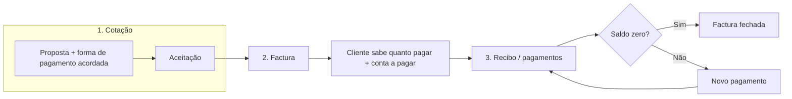
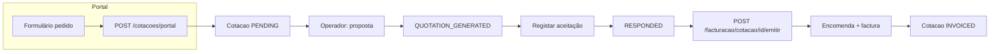

# Fluxo de cotação, factura e recibo (Lirandzo)

Documento de referência: **fluxo de negócio desejado** (produto alvo) e **comportamento actual** do código onde aplicável (`CotacaoService`, `FacturacaoService`, `Encomenda`, área de facturação no Angular).

---

## 1. Conceitos (factura vs recibo)

| Conceito | Função |
|----------|--------|
| **Cotação** | Proposta comercial; aqui deve ficar definida a **forma de pagamento acordada** com o cliente (pagamento total, parcial, após recepção do produto, etc.). As opções são descritas **sem IVA** — o IVA continua a ser tratado na factura conforme regras fiscais. |
| **Factura** | Documento que **indica ao cliente o valor que deve pagar**, emitido **a partir da cotação** aceite. A factura **acompanha** a forma de pagamento definida na cotação (não é necessário “reinventar” o método noutro sítio). |
| **Recibo** | Registo dos **pagamentos efectivos** face à factura (quanto pagou, quanto falta). Vários recibos/pagamentos parciais podem existir até liquidar o total. |

**Ordem correcta do fluxo:**

1. **Cotação** → 2. **Factura** (emitida com base na cotação) → 3. **Recibo** (pagamentos registados sobre essa factura).

No backend actual, a “factura” materializa-se como **encomenda** (`Encomenda`) com número de factura, ligada à cotação; o valor em dívida deriva de `valorTotal` vs `valorPago`. O termo **recibo** no dia-a-dia corresponde à **gestão de pagamentos** (registos que aumentam `valorPago` / baixas), não necessariamente a um PDF de “recibo” isolado no código.

---

## 2. Entrada: pedido pelo portal

1. O utilizador preenche o formulário em **Solicitar cotação** (`request-quote`).
2. O frontend chama `POST .../cotacoes/portal`.
3. O backend cria **cliente** (se necessário) e **cotação** com `status` = **`PENDING`**, `fontePedido` = **`PORTAL`**, etc.

**Referência:** `CotacaoService.criarPedidoAPartirDoPortal`, `CotacaoController` `POST /cotacoes/portal`.

---

## 3. Estados da cotação (`StatusCotacao`)

Definidos em `Cotacao.StatusCotacao`:

| Estado (API) | Papel no fluxo |
|--------------|----------------|
| **PENDING** | Pedido recebido |
| **QUOTATION_GENERATED** | Proposta gerada / enviada |
| **RESPONDED** | Aceitação pelo contacto registada — pré-requisito típico para **emitir factura** |
| **INVOICED** | Já existe documento de facturação (encomenda/factura) para esta cotação |
| **EXPIRED** / **CANCELLED** | Não seguem para facturação |

**Especificação alvo (cotação):** além dos valores e linhas, o cadastro da cotação deve permitir **definir a forma de pagamento acordada** (total, parcial, após recepção, …). A factura herda essa informação; não faz sentido obrigar a preencher de novo um “método de pagamento” na emissão da factura como se fosse independente.

---

## 4. Layout e páginas no billing (visão alvo)

Alinhamento com o menu **Factura & recibo** (sidebar): **1** cotações para facturar, **2** nova factura, **3–4** um único ecrã (`/billing/encomendas`) para **recibo** (registar pagamentos) e **lista de todas as facturas** (pagas e por pagar, com acções conforme perfil).

### 4.1 Página «Nova factura» (emitir a partir da cotação)

- O primeiro passo é **emitir a factura com base na cotação** (não o contrário).
- **Data de emissão:** automática (data do sistema no momento da emissão).
- **Método de pagamento:** não deve ser um campo redundante a preencher manualmente se já vem da cotação; o que se acrescenta na factura é sobretudo o **número da conta a pagar** (referência bancária / conta onde o cliente deve pagar), coerente com o acordo na cotação.
- **Antes de finalizar:** o utilizador deve **confirmar** se todos os dados estão correctos.

**Implementação actual:** `POST /api/facturacao/cotacao/{cotacaoId}/emitir` cria `Encomenda` com `dataEncomenda` = hoje, gera número de factura, cotação → `INVOICED`. Ajustes finos de UI (confirmação explícita, campo só “conta a pagar”) podem estar em evolução.

### 4.2 Página «Recibo e lista de facturas» — gestão de pagamentos

**Função:** **registar os pagamentos** das facturas (ex.: factura X pagou 5 000, falta Y; pode registar-se novo pagamento enquanto houver saldo).

Tabela simples sugerida (conceito de produto):

| Coluna / ideia |
|----------------|
| Nome do cliente |
| Factura (número) |
| Data da factura |
| Valor total da factura |
| Valor em dívida / em falta |
| Forma acordada de pagamento (total, parcial, após recepção do produto, …) |

**Regras:**

- Se a factura estiver **paga na totalidade**, **fecha**: não é possível registar mais pagamentos.
- Em caso de erro, perfil **gestor** ou **admin** pode **reverter** a acção (estorno / correcção de registos).
- **Técnico** pode registar facturas / valores.
- Perfil de **revisor** (ex.: referência interna “Nilo”): vê os valores registados, pode **aprovar** ou **recusar** e **escrever o motivo** da recusa.

**Implementação actual:** a lista de encomendas (`/billing/encomendas`) mostra totais, pago e dívida; fluxo de aprovação “Nilo” e reversão por gestor pode ainda não existir — tratar como roadmap.

### 4.3 «Lista de facturas» (visão geral)

- Lista **todas** as facturas **pagas** e **por pagar**.
- Para linhas **não pagas** (ou com saldo): botões **Pagar** e **Ver** (e, onde fizer sentido para permissões, acesso a **acções / direitos** — botão ou menu de operações conforme perfil).

Na prática, esta visão pode coincidir com o mesmo ecrã que a gestão de pagamentos (filtros e botões), ou evoluir para separação por tabs; o documento descreve o comportamento esperado.

### 4.4 Outras áreas

- **Cotações para facturar:** ponto de entrada para cotações prontas a passar a factura.
- **Facturas pagas:** atalho para ver só documentos liquidados.
- **Baixas e tesouraria:** conciliação com movimentos bancários (complementar aos recibos).

---

## 5. Facturação técnica (backend actual)

`FacturacaoService.emitirFacturaDeCotacao(cotacaoId)`:

1. Cotação existe; não pode já existir encomenda para essa cotação.
2. Estados bloqueados: `CANCELLED`, `EXPIRED`, `INVOICED`.
3. Estado permitido: **`RESPONDED`** (aceitação registada).
4. Valor facturável > 0.
5. Cria `Encomenda`, `valorPago` = 0, liga `cotacao`, `dataEncomenda` = hoje; gera número de encomenda e de factura; cotação → **`INVOICED`**.

**Endpoint:** `POST /api/facturacao/cotacao/{cotacaoId}/emitir`

---

## 6. Diagrama do fluxo (negócio)

---

## 7. Diagrama técnico (portal + API)

---

## 8. Ficheiros úteis no repositório

| Área | Ficheiros |
|------|-----------|
| Portal → API | `CotacaoController.java`, `CotacaoPortalRequestDTO`, `cotacao.service.ts` |
| Estados | `Cotacao.java`, `CotacaoService.java` |
| Factura | `FacturacaoService.java`, `FacturacaoController.java`, `EncomendaService.java` |
| UI cotações | `cotacoes-cadastro.component.ts`, `cotacoes-enviadas.component.ts` |
| UI facturas / lista | `encomendas-*.component.ts` |
| Rastreio (encomenda) | `RastreamentoService.java`, `RastreamentoController.java`, `encomendas-detalhe` |

Ver também `Documentacao/rastreamento-interno.md`.

---

*Última actualização: fluxo de negócio (cotação → factura → recibo), páginas e perfis alinhados à especificação interna; detalhes de implementação sujeitos a evolução do código.*
